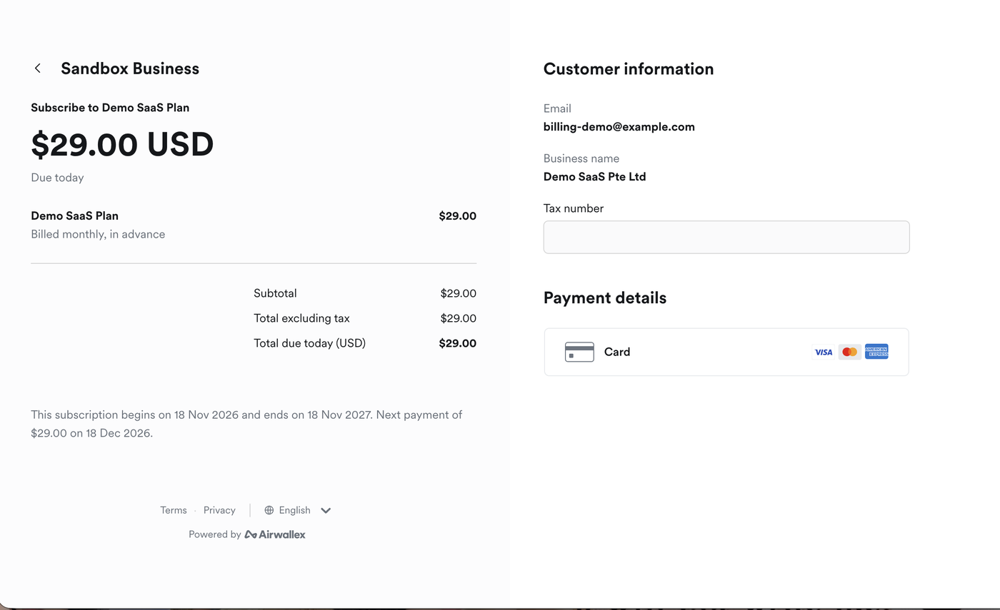

# airwallex-billing-lifecycle

A hands-on test of one question: when a subscription renewal fails, how visible and traceable is it across Airwallex Billing and Payments?

Everything here was run in the Airwallex sandbox with Python. No real money, no real customers.

**Why I built this.** I've sold payments, FX and treasury products to founders and finance teams across five Asian markets. I haven't sold billing as a standalone product, so I tested Airwallex Billing myself instead of only reading about it.

## Key takeaways (read this first)

1. **A failed renewal can be traced with IDs alone.** Invoice, billing transaction, Payment Intent, payment attempt. No manual matching. I checked this on one paid and one failed charge.
2. **The layers don't move together.** After the failed charge the attempt was `FAILED` and the subscription was `UNPAID`, but the billing transaction still said `CREATED`. Anyone building on this should read the payment layer's status, not only the billing one.
3. **Retry behaviour on a daily plan:** One retry fired about two hours after the first attempt and failed again. The subscription then went from `UNPAID` to `CANCELLED`. This matches the dunning docs for a daily cycle (one retry, two attempts in total). I have not confirmed whether `CANCELLED` is the default or a setting.
4. **Not tested:** webhook delivery, retry schedules for longer cycles, and any approval-rate or recovery-rate uplift. A sandbox can't show those.

## Problem

Subscription businesses selling across currencies lose recurring revenue to failed renewals, not only to cancellations. Finance teams then struggle to see why a renewal failed, whether it recovered, and which payment settled which invoice. This repo follows one subscription through its billing lifecycle to see how much of that is visible and recoverable in one system.

## Who this is for

A mid-market subscription business in Asia that bills in several currencies, has a finance team but no large engineering team, and has outgrown a basic billing tool without reaching the scale where a heavy enterprise payments setup makes sense.

## Hypothesis

For this kind of business, one platform handling billing, payments and reconciliation should let a failed renewal be traced from invoice to payment attempt to retry to settlement through one ID chain, with no manual matching.

**Assumption I did not test:** that this buyer exists and feels this pain. That needs customer conversations, not a sandbox.

## What I ran

| Script | What it does |
|---|---|
| `01_auth.py` | Gets an access token with a scoped API key |
| `02_setup.py` | Creates a customer, a product and a monthly USD price |
| `03_checkout.py`, `03b_check.py` | Starts a subscription through hosted Billing Checkout, then checks the result |
| `04_force_failure.py` | Adds an 80.51 USD item and charges immediately. The test card declines that exact amount |
| `04b_inspect.py`, `04c_status.py` | List invoices, billing transactions, Payment Intents and attempts, and check statuses |
| `04d_webhook_test.py` | Changes a subscription note to trigger an event |
| `05_daily_checkout.py`, `05b_daily_check.py` | Same setup on a daily plan, so retries show up within hours |
| `06_fail_and_watch.py`, `06b_watch_only.py` | Forces the failure on the daily plan and polls every 5 minutes, logging every change to `evidence/retry_log.jsonl` |

The price is in USD on a Singapore account, which covers the multi-currency case. Settlement was not tested.

## Findings

**The ID chain**

Invoice -> billing transaction (`invoice_id`) -> Payment Intent (`external_id` on the transaction) -> payment attempt.

**One failed charge, layer by layer** (80.51 USD add-on, charged immediately, test card declined)

| Layer | Status |
|---|---|
| Subscription | UNPAID |
| Invoice | FINALIZED, payment UNPAID |
| Billing transaction | CREATED |
| Payment Intent | REQUIRES_PAYMENT_METHOD |
| Payment attempt | FAILED (`authorization_failed`) |

The paid invoice looked like this: invoice PAID, transaction SUCCEEDED, Payment Intent SUCCEEDED.

**Other things I noticed**
- Subscriptions created through checkout use `AUTO_CHARGE`.
- The subscription's `latest_invoice_id` lagged the new invoice for a short while.
- The failure code was generic. The sandbox doesn't show issuer-level detail, so this says nothing about production decline codes.

**Where the docs and the API disagreed**
- The Checkout docs example includes `payment_method_save`. The API rejects it in SUBSCRIPTION mode.
- Two docs pages give different retry schedules: one by cycle length, one a fixed set of days.
- Endpoint paths and sandbox base URLs differ between pages (`api-demo` and `api.sandbox`).
- Webhook event names depend on the API version.

## Retry and end state (daily plan)

Times are UTC. I poll every 5 minutes, so timing is accurate to about 5 minutes.

- **First attempt** `att_sgpvgxw68ho9qws28ui_wrt094`: received at 08:15, failed by 08:21. Subscription went `UNPAID`.
- **Second attempt** `att_sgpvl8q88ho9u7vn1om_wrt094`: first seen at my 10:17 poll, about two hours after the first. It failed with the same generic `authorization_failed`.
- **End state:** at that same poll the subscription went `CANCELLED`.
- **Still unpaid:** the invoice stayed `FINALIZED` and `UNPAID`, the billing transaction stayed `CREATED`, and the Payment Intent stayed `REQUIRES_PAYMENT_METHOD`.

The raw log is in `evidence/retry_log.jsonl`. It records changes only, so nothing was logged between 08:21 and 10:17.

## My view

The part I liked most is that one failed renewal can be followed from the invoice all the way to the card attempt using IDs only. I didn't have to match anything by hand. Setup was quick too.

The part that slowed me down was the developer side. A couple of things in the docs didn't match what the API did, and my first API key got rejected until I made an org-level scoped one. I also found it odd that the attempt said failed while the billing transaction still said created. A customer's engineers would trip on the same things.

## Questions I'd ask a customer

1. Roughly what share of renewals fail on the first attempt? (If they don't know, that's a finding in itself.)
2. When a renewal fails, who finds out, how, and how long does it take to learn why?
3. Which currencies do you bill in, and which do you settle in?
4. How does finance match a payment to an invoice today: spreadsheet, export, or a tool?
5. How many systems touch one renewal, from billing tool to payment provider to the bank?
6. Who owns this: finance, RevOps or engineering?
7. What happens to a customer whose renewal fails: access cut, grace period, or a manual chase?
8. What would a one-point drop in failed renewals be worth over a year?

## What I'd tell a customer

**To a CFO or finance lead**

> When a renewal fails, you need to know three things: that it failed, why, and whether the money came back, and which invoice it belongs to. In a sandbox test I followed a failed charge from the invoice, through the billing transaction and the Payment Intent, to the payment attempt, using IDs the platform generates. No spreadsheet matching. I can't tell you your recovery rate, because that depends on live data, but I can show you where to look and how quickly you'd see it.

**To a CTO or Head of Payments**

> Billing and payments are two layers that share IDs: the invoice links to a billing transaction, whose external ID is the Payment Intent. Statuses don't always move together. In my test the attempt was `FAILED` while the billing transaction still said `CREATED`, so build around the payment layer's status, not only the billing one. Checkout-created subscriptions use auto-charge. Webhooks are documented, but I didn't capture them in my test, so I wouldn't promise event timing without testing it with your setup.

**What I would not say**
- Any approval-rate or recovery-rate uplift. A sandbox can't show it.
- Anything about production decline codes.

## What this cannot show

The sandbox uses simulated money. It can't prove approval-rate uplift or real recovery rates. It only shows what is visible and traceable in the product.

## Not covered

- Webhook delivery. I set up an endpoint but did not capture events.
- Retry schedules for 2 to 6 day and 7+ day cycles. I only tested a daily cycle.
- Usage-based billing, credit notes, tax and alternative payment methods. Studied, not built.

## Setup

1. Create a sandbox account and an organisation-level scoped API key with Billing write access and Payments read access. Admin keys are rejected.
2. Copy `.env.example` to `.env` and fill in the client ID and API key. Never commit `.env`.
3. `python3 -m pip install requests python-dotenv`
4. Run the scripts in order.

## Status

- [x] 01 authenticate
- [x] 02 customer, product, price
- [x] 03 subscription via checkout
- [x] 04 forced failed charge and ID chain
- [x] 05 daily-plan retry test
- [ ] Webhook events captured
- [ ] One-off invoice

Built by Ploypalin Tan. Sandbox only. Not affiliated with Airwallex.
